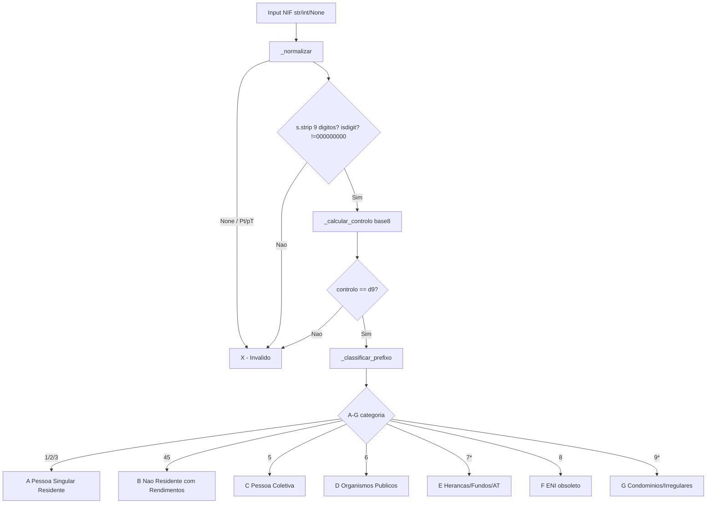
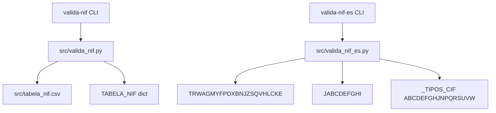
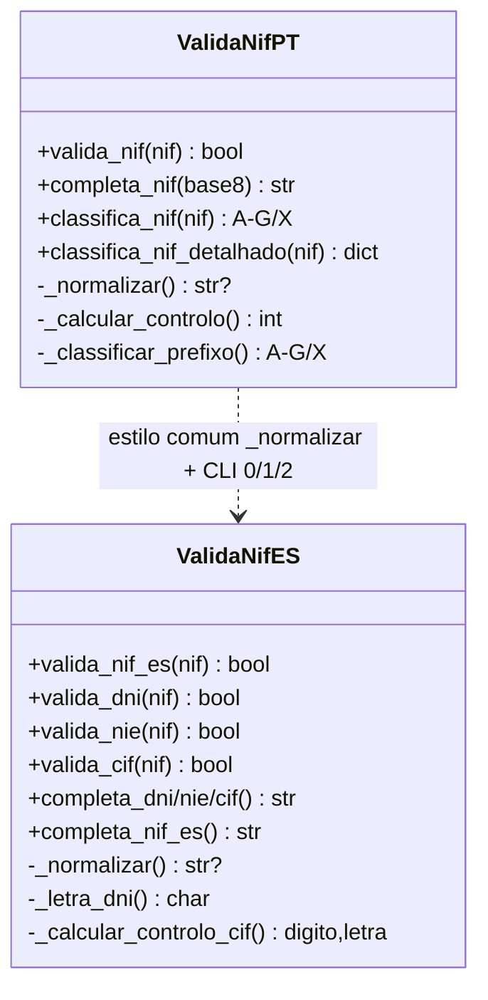

# Arquitetura

## Visão Geral

```
src/valida_nif.py      -> PT: valida_nif, completa_nif, classifica_nif
src/valida_nif_es.py   -> ES: valida_nif_es, valida_dni/nie/cif, completa_*
src/tabela_nif.csv     -> mapeamento PT indice->categoria
valida_nif_es.py       -> shim raiz (re-exporta src/valida_nif_es.py)
docs/                  -> documentação técnica e utilizador
```

## Fluxo de Validação e Classificação — PT



## Fluxo de Validação — ES (DNI/NIE/CIF)

```mermaid
flowchart TD
    A[Input ES str/int/None] --> B[_normalizar ES/es + strip -/space + upper]
    B -->|None / Es/eS| X[False]
    B --> C{len==9?}
    C -->|Nao| X
    C -->|Sim| D{tipo?}
    D -->|8 digitos+letra| E[valida_dni mod23 TRWAGMYFPDXBNJZSQVHLCKE]
    D -->|XYZ+7+letra| F[valida_nie XYZ->0/1/2 + mod23]
    D -->|letra CIF+7+d/l| G[valida_cif soma ponderada + JABCDEFGHI]
    E --> H{letra==Tabela[n%23]?}
    F --> H
    G --> I{ABEH so digito? PQSNW so letra? resto ambos}
    H -->|Sim| V[True]
    H -->|Nao| X
    I -->|Sim| V
    I -->|Nao| X
```

## Componentes



## Classes (PT vs ES)



## Módulos

| Módulo | Responsabilidade |
|---|---|
| `_normalizar` (PT) | trim, PT/pt, None para prefixo invalido |
| `_calcular_controlo` (PT) | soma ponderada 9..2 mod11 |
| `valida_nif` (PT) | bool 9 digitos + controlo |
| `completa_nif` (PT) | 8->9 digitos |
| `classifica_nif` (PT) | reutiliza valida_nif, devolve A-G/X |
| `_classificar_prefixo` (PT) | prioridade 45/70/71... antes de 1-char |
| `TABELA_NIF` (PT) | dict em memoria, fallback CSV |
| `_normalizar` (ES) | trim, ES/es, remove -/espaco, upper |
| `_letra_dni` (ES) | TRWAGMYFPDXBNJZSQVHLCKE[n%23] |
| `_calcular_controlo_cif` (ES) | soma pares + dobra impares + JABCDEFGHI |
| `valida_dni` (ES) | 8 digitos+letra mod23 |
| `valida_nie` (ES) | XYZ+7+letra XYZ->0/1/2 |
| `valida_cif` (ES) | letra+7+d/l ABEH so digito PQSNW so letra |
| `valida_nif_es` (ES) | dispatcher DNI/NIE/CIF |
| `completa_dni/nie/cif` (ES) | 8->9 chars por tipo |

## Decisões

- `classifica_nif` retorna `X` em vez de levantar, para uso batch CLI.
- `45` verificado antes de `4` (4 isolado = X).
- `8` mapeado para `F` com estado obsoleto, não erro.
- CSV carregavel mas não obrigatório; dict hardcoded garante offline.
- ES `Es/eS` rejeitado (apenas `ES`/`es`), coerente com PT `Pt/pT`.
- CIF `ABEH` só dígito, `PQSNW` só letra, resto ambos — regra AEAT pós-2008.
- ES remove `-` e espaço e aplica `upper()` para aceitar `12345678-Z` / `X-1234567-L`.
