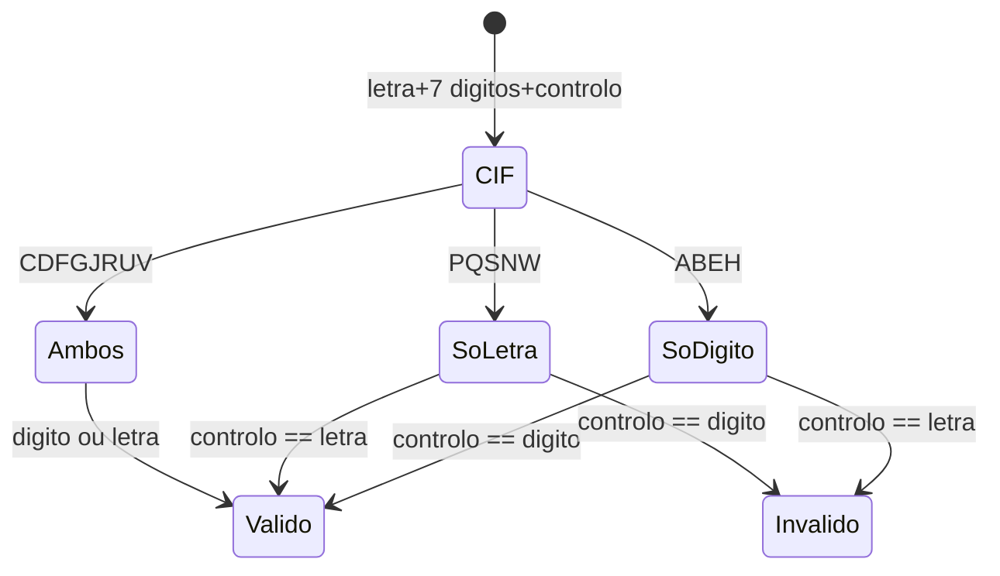

# Tabela NIF ES — DNI/NIE/CIF

Fonte: `src/valida_nif_es.py` — validação espanhola (`TRWAGMYFPDXBNJZSQVHLCKE` + `JABCDEFGHI`).

## Tipos de NIF Espanhol

| Tipo | Formato | Exemplo | Controlo | Descrição |
|---|---|---|---|---|
| DNI | 8 dígitos + letra | `12345678Z` | `n % 23 → TRWAGMYFPDXBNJZSQVHLCKE` | Particular espanhol (Documento Nacional de Identidad) |
| NIE | `X/Y/Z` + 7 dígitos + letra | `X1234567L` | `X→0 Y→1 Z→2` + `mod23` | Estrangeiro residente (Número de Identidad de Extranjero) |
| CIF/NIF | letra + 7 dígitos + dígito/letra | `A58818501` | soma ponderada + `JABCDEFGHI` | Pessoa jurídica (antigo CIF, hoje NIF) |

## Tabela DNI — `TRWAGMYFPDXBNJZSQVHLCKE`

| Resto `n % 23` | 0 | 1 | 2 | 3 | 4 | 5 | 6 | 7 | 8 | 9 | 10 | 11 | 12 | 13 | 14 | 15 | 16 | 17 | 18 | 19 | 20 | 21 | 22 |
|---|---|---|---|---|---|---|---|---|---|---|---|---|---|---|---|---|---|---|---|---|---|---|---|
| Letra | T | R | W | A | G | M | Y | F | P | D | X | B | N | J | Z | S | Q | V | H | L | C | K | E |

Ex: `12345678 % 23 = 14 → Z` → `12345678Z` válido.

## Tabela CIF — `JABCDEFGHI` (controlo)

| Dígito | 0 | 1 | 2 | 3 | 4 | 5 | 6 | 7 | 8 | 9 |
|---|---|---|---|---|---|---|---|---|---|---|
| Letra | J | A | B | C | D | E | F | G | H | I |

Cálculo: `soma_par` = dígitos em posições pares (2,4,6), `soma_impar` = soma dos dígitos de `d*2` em posições ímpares (1,3,5,7), `total = soma_par + soma_impar`, `digito = (10 - total%10)%10`, `letra = JABCDEFGHI[digito]`.

## CIF — Letras Iniciais e Regras de Controlo

| Letra | Categoria | Controlo | Exemplo válido |
|---|---|---|---|
| A | Sociedade Anónima | só dígito | `A58818501` |
| B | Sociedade de Responsabilidade Limitada | só dígito | `B12345674` |
| E | Comunidade de Bens | só dígito | `E12345674` |
| H | Comunidade de Proprietários | só dígito | `H12345674` |
| P | Corporação Local | só letra | `P1234567D` |
| Q | Organismo Público | só letra | `Q2826000H` |
| S | Órgão da Administração | só letra | `S1234567D` |
| N | Entidade Estrangeira | só letra | `N1234567D` |
| W | Estabelecimento Estrangeiro | só letra | `W1234567D` |
| C | Sociedade Colectiva | dígito ou letra | `C12345674` / `C1234567D` |
| D | Sociedade Comanditária | dígito ou letra | `D12345674` / `D1234567D` |
| F | Sociedade Cooperativa | dígito ou letra | `F12345674` |
| G | Associação | dígito ou letra | `G12345674` |
| J | Sociedade Civil | dígito ou letra | `J12345674` |
| R | Congregação Religiosa | dígito ou letra | `R12345674` |
| U | UTE | dígito ou letra | `U12345674` |
| V | Sociedade Agrária Transformação | dígito ou letra | `V12345674` |

Conjunto completo `_TIPOS_CIF = ABCDEFGHJNPQRSUVW` (exclui `I,O`).

## Regra CIF — Estado

## Exemplos CIF

| Base 8 | Completo dígito | Completo letra | Válidos |
|---|---|---|---|
| `A5881850` | `A58818501` | — | só dígito |
| `Q2826000` | — | `Q2826000H` | só letra |
| `C1234567` | `C12345674` | `C1234567D` | ambos |
| `S1234567` | — | `S1234567D` | só letra |

## Normalização ES

- Aceita `ES`/`es` apenas; `Es`/`eS` → inválido (coerente com PT `PT`/`pt`).
- Remove `-` e espaço e aplica `upper()`: `12345678-Z`, `X-1234567-L`, `es x1234567l` válidos.
- Comprimento fixo 9 após normalização.
