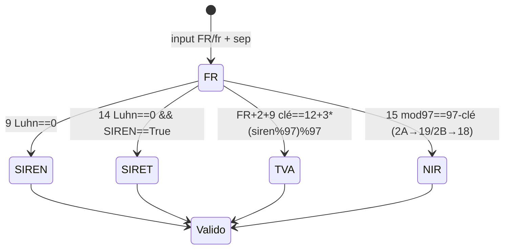

# Tabela NIF FR — SIREN/SIRET/TVA/NIR

Fonte: `src/valida_nif_fr.py` — validação francesa (Luhn + TVA mod97 + NIR mod97). Base legal: INSEE / Code de Commerce / Directive TVA UE.

## Tipos de Identificador Francês

| Tipo | Formato | Exemplo | Controlo | Descrição |
|---|---|---|---|---|
| SIREN | 9 dígitos | `732829320` | **Luhn mod10** | Entreprise — INSEE (Sirène) |
| SIRET | 14 dígitos = SIREN 9 + NIC 4 + dígito 1 | `73282932000074` | Luhn 14 + SIREN válido | Établissement |
| TVA intracomm. | `FR` + 2 dígitos + SIREN 9 | `FR40303265045` | `clé=(12+3*(SIREN%97))%97` | N° TVA UE |
| NIR (NISS) | 15 dígitos = 13 base + 2 chave | `184127500112356` | `clé=97-(n%97)` | Personne physique — INSEE (Sécurité sociale) |

## SIREN / SIRET — Luhn mod10

Algoritmo idêntico a cartões bancários. Da direita para a esquerda dobra-se cada 2º dígito; se `>9` subtrai-se `9`; soma `total % 10 == 0` → válido.

| Base 8 | SIREN completo | Base SIRET 13 | SIRET completo |
|---|---|---|---|
| `73282932` | `732829320` | `7328293200007` | `73282932000074` |
| `55210055` | `552100554` | `55210055400013` | `55210055400013` |

Cálculo: `_calcular_luhn(base)` → `base + "0"` + `total` → dígito `(10 - total%10)%10`.

### Validação SIRET

1. 14 dígitos e `isdigit`
2. `valida_siren(s[:9]) == True`
3. `Luhn(14) == True`

> SIRET contém SIREN válido — rejeita SIRET com Luhn correto mas SIREN inválido.

## TVA Intracommunautaire — `FRxx + SIREN`

```
chave = (12 + 3 * (SIREN % 97)) % 97   # 0..96, 2 dígitos zero-padded
TVA   = "FR" + f"{chave:02d}" + SIREN
```

Validação: `valida_siren(siren)` e `int(chave) == esperado`. A TVA só é válida se o SIREN subjacente for Luhn-válido.

| SIREN | chave | TVA |
|---|---|---|
| `303265045` | `40` | `FR40303265045` |
| `552100554` | `96` | `FR96552100554` |
| `732829320` | `44` | `FR44732829320` |
| `443061841` | `64` | `FR64443061841` |

Nota: `FR`/`fr` apenas (`Fr`/`fR` inválido, coerente com PT `PT`/`pt` e ES `ES`/`es`). Aceita separadores ` `, `-`, `.`.

## NIR — Numéro d'Inscription au Répertoire (15)

Formato `s aa mm dep com ord clé` (13 + 2):

| Pos | Campo | Valores | Exemplo `1841275001123` |
|---|---|---|---|
| 1 | Sexo | `1`=H `2`=F `7`/`8` temp. | `1` |
| 2-3 | Ano nascimento | `00-99` | `84` |
| 4-5 | Mês | `01-12` (+ `20` Corsica?) | `12` |
| 6-7 | Departamento | `01-95` ou `2A`/`2B` | `75` |
| 8-10 | Commune | INSEE | `001` |
| 11-13 | Ordre | `001-999` | `123` |
| 14-15 | Clé | `01-97` | `56` |

### Controlo NIR

```
# Caso geral (só dígitos, 13 chars)
clé = 97 - (int(base13) % 97)

# Córsega: dep=2A → "19", dep=2B → "18" para cálculo
num_str = base[:5] + ("19" if dep=="2A" else "18") + base[7:]  # 13 dígitos numéricos
clé = 97 - (int(num_str) % 97)
```

| Base 13 | NIR completo |
|---|---|
| `1841275001123` | `184127500112356` |
| `184122A888123` → `2A` | `184122A88812381` (calculado com `19`) |
| `284122B888123` → `2B` | `284122B888123xx` (calculado com `18`) |

Validação: sexo ∈ `1278`, 13 chars com `2A`/`2B` permitido apenas em `dep`, `clé == 97 - (n%97)`.

## Normalização FR

- Aceita `FR`/`fr` apenas; `Fr`/`fR` → inválido (nulo).
- Remove `-`, espaço e `.`, aplica `upper()`: `FR 40 303265045`, `732829320-00074`, `fr732829320` válidos.
- Comprimento fixo após normalização: 9 (SIREN), 14 (SIRET), 11 (TVA sem FR / 13 com FR), 15 (NIR).



## Comparativo PT/ES/FR

| Aspeto | PT | ES | FR |
|---|---|---|---|
| Identificadores | NIF 9 mod11 | DNI/NIE/CIF mod23/CIF | SIREN/SIRET Luhn TVA mod97 NIR mod97 |
| Prefixo | `PT`/`pt` | `ES`/`es` | `FR`/`fr` |
| Separadores | trim | `-`/espaço | `-`/espaço/`.` |
| Tipos empresa | C/D/G | CIF | SIREN/SIRET/TVA |
| Pessoa singular | A/B/E/F | DNI/NIE | NIR |
